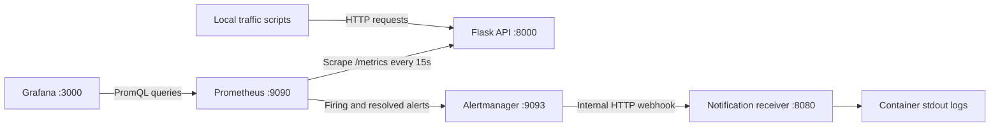

# Flask SRE Observability Lab

A local SRE learning and demonstration project that instruments a Flask API, visualizes service behavior, evaluates alerts, delivers local webhook notifications, and measures a request-based availability SLO.

The stack uses Flask, Prometheus, Grafana, Alertmanager, and Docker Compose. It demonstrates the path from a request to a metric, a dashboard, an actionable alert, and a recovery investigation. It is designed for localhost and is not production-ready.

## What this project demonstrates

- Request counters and latency histograms with bounded route labels.
- PromQL for request rate, HTTP errors, P95 latency, availability, and error budgets.
- Provisioned Grafana dashboards and persistent local monitoring storage.
- Sustained-condition alerting with traffic guards and synthetic rule tests.
- Alertmanager grouping, routing, and firing/resolved webhook delivery.
- Bounded incident simulation, recovery verification, and incident documentation.
- Honest reporting of partial metric history before a rolling 30-day SLO can be assessed.

## Architecture



Published ports bind to `127.0.0.1`. The receiver has no published host port. Container connections use Docker service DNS: `api`, `prometheus`, `alertmanager`, and `webhook-receiver`.

## Prerequisites and Windows PowerShell setup

Have Git (if cloning), Docker with Compose and Linux-container support, and a working Docker daemon available. Python 3.12 is the container runtime; an existing Python 3 installation is needed only for host-side scripts/tests. Windows 10/Docker compatibility depends on your edition, build, and installed Docker version; verify your environment rather than assuming compatibility.

No setup tool is installed by this repository. The first Compose build/pull downloads container images and installs Python packages **inside the API image**. Run those operations only when you choose to allow them.

From the project folder in PowerShell:

```powershell
# Create credentials only if .env does not already exist.
if (-not (Test-Path .env)) { Copy-Item .env.example .env }
notepad .env
```

Replace the password placeholder with a strong local Grafana password. `.env` is ignored; commit only `.env.example`. Then:

```powershell
# Quiet validation avoids printing expanded credentials.
docker compose config --quiet
# Downloads/builds as needed; run only when you approve those operations.
docker compose up --build -d
docker compose ps
```

For an existing stack with all images already available, startup without builds or pulls is:

```powershell
docker compose up -d --no-build --pull never
```

Use your `.env` credentials to sign into Grafana. Initial administrator credentials initialize a new Grafana data volume; editing `.env` does not reset an existing user's password. The Prometheus data source and both dashboards provision automatically.

## Local interfaces and API endpoints

| Interface | URL | Behavior |
| --- | --- | --- |
| Liveness | http://localhost:8000/health | HTTP 200 with health JSON; no dependency readiness check |
| Orders | http://localhost:8000/api/orders | HTTP 200 with static sample orders |
| Deliberate failure | http://localhost:8000/api/error | HTTP 500 with JSON; intentional demo behavior |
| Deliberate delay | http://localhost:8000/api/slow | HTTP 200 after a fixed one-second delay |
| Metrics | http://localhost:8000/metrics | Prometheus exposition text |
| Prometheus | http://localhost:9090 | Queries, target status, and rules |
| Alerts | http://localhost:9090/alerts | Prometheus evaluation states |
| Grafana | http://localhost:3000 | Provisioned dashboards |
| Alertmanager | http://localhost:9093 | Received alerts, grouping, and silences |

GET routes also support Flask's HEAD/OPTIONS handling. The optional legacy `/test/error` and `/test/slow` routes require `ENABLE_TRAFFIC_TEST_ENDPOINTS=true`; the `/api/*` routes are always registered. Flask registers a static-file route, but no static assets are provided.

## Verify the running stack

```powershell
Invoke-RestMethod -Uri http://localhost:8000/health -TimeoutSec 5
Invoke-RestMethod -Uri http://localhost:8000/api/orders -TimeoutSec 5
(Invoke-WebRequest -Uri http://localhost:8000/metrics -UseBasicParsing -TimeoutSec 5).Content
Measure-Command {
    Invoke-WebRequest -Uri http://localhost:8000/api/slow -UseBasicParsing -TimeoutSec 5 | Out-Null
}

# Windows PowerShell throws on HTTP 500; confirm the expected response.
try {
    Invoke-WebRequest -Uri http://localhost:8000/api/error -UseBasicParsing -TimeoutSec 5 -ErrorAction Stop | Out-Null
    throw 'Expected HTTP 500, but the request succeeded.'
} catch {
    if ($null -eq $_.Exception.Response) { throw }
    $status = [int]$_.Exception.Response.StatusCode
    if ($status -ne 500) { throw }
    Write-Output "Expected HTTP status: $status"
}

Invoke-WebRequest -Uri http://localhost:9093/-/ready -UseBasicParsing -TimeoutSec 5
(Invoke-RestMethod http://localhost:9090/api/v1/alertmanagers).data
docker compose logs --tail=50 api prometheus alertmanager webhook-receiver
```

In Prometheus, `up{job="flask-api"}` should be 1 and rule health should be `ok`. Allow at least two scrapes for a newly created counter series; estimates need sufficient traffic. Calling `/api/error` intentionally adds failures to your metrics and budget.

## Metrics and dashboards

| Metric | Labels | Meaning |
| --- | --- | --- |
| `flask_http_requests_total` | `method`, `endpoint`, `status` | Completed request counter |
| `flask_http_request_duration_seconds` | `method`, `endpoint`; generated buckets add `le` | Request latency histogram in seconds |

The application excludes `/metrics` scrapes from instrumentation and groups unknown URLs under `endpoint="unmatched"`. Health checks still increment `/health`; user-traffic queries exclude both `/health` and `/metrics`. Status belongs to the counter, not the histogram.

- [SRE - Flask Service Overview](http://localhost:3000/d/sre-flask-service-overview/sre-flask-service-overview): request rate (req/s), 5xx percentage, P95 latency (ms), and five-minute availability with a 99.9% reference line. Existing long-window observations are explicitly marked potentially partial.
- [SRE - Flask Availability SLO](http://localhost:3000/d/sre-flask-availability-slo/sre-flask-availability-slo): history status, fixed objective, observed request totals, budget calculations, provisional previews, and history-gated full-window results.

Both default to the last 15 minutes. Their queries use fixed five-minute or 30-day lookbacks; the displayed range does not shorten those calculation windows. JSON is the source of truth; Grafana polls changes every 30 seconds.

No screenshots are included yet. See the [screenshot capture guide](docs/screenshots/README.md) for suggested evidence and redaction requirements.

## Alert evaluation and notification delivery

Prometheus evaluates **FlaskHighErrorRate** every 15 seconds. It requires a five-minute 5xx ratio strictly above 5%, at least 20 estimated eligible requests in that window, and positive request activity over the last minute. All conditions must remain true for five continuous minutes. Severity is `warning`.

**Inactive** means the expression is not active. **Pending** means it is active but the hold is incomplete. **Firing** means it persisted throughout the hold. Inactivity alone is not proof of recovery: traffic or monitoring may have disappeared.

Alertmanager handles notification delivery separately. It groups by `alertname`, `job`, and `service`; routes everything to the internal `local-webhook` receiver; waits 10 seconds for a new group; checks changed groups every minute; and repeats unchanged firing notifications every ten minutes. `send_resolved: true` delivers resolutions. Pending is not a notification event. Silence/group timing/receiver failures can delay or suppress delivery even if the rule is Firing.

The receiver logs whitelisted status, labels, and timestamps, omitting arbitrary annotations and headers. A firing or resolved receiver log is delivery evidence; seeing the alert in Prometheus alone is not. No external notification service, credentials, or paid API is required.

## Simulate an incident and recover

Use an existing Python installation. `python` can replace `py -3` when that is your working command.

```powershell
# Seven minutes, one sequential request/second, 70% errors per full 10-request cycle.
py -3 scripts/simulate_incident.py
# Configurable duration in minutes and rate in requests/second.
py -3 scripts/simulate_incident.py --duration 8 --rate 2 --timeout 5
```

The simulator fixes its target to IPv4 localhost, disables proxies/redirects, bounds the rate to 0.1–10 req/s, uses timeouts, reports every 30 seconds, and stops safely with Ctrl+C. A partial cycle or other traffic can change the observed ratio. The alternative `scripts/generate_traffic.py --count 30 --delay 0.5` cycles orders, errors, and slow requests.

In another terminal:

```powershell
docker compose logs -f --tail=20 webhook-receiver alertmanager
```

Expected behavior is Pending, Firing after five continuous qualifying minutes, then a firing webhook after grouping delay. Stop failure traffic and send healthy eligible requests:

```powershell
1..360 | ForEach-Object {
    Invoke-WebRequest -Uri http://localhost:8000/api/orders -UseBasicParsing -TimeoutSec 5 | Out-Null
    Start-Sleep -Seconds 1
}
```

Confirm healthy responses, successful scrapes, declining errors, alert inactivity, and a resolved webhook log. Recovery timing depends on actual traffic, scrape/evaluation timing, and notification grouping. Simulated failures remain in the rolling SLO window; do not erase history to make results look healthy.

## Availability SLO and error budget

The objective is **99.9% non-5xx eligible requests over a rolling 30 days**. Eligible requests exclude `/health` and `/metrics`; 4xx counts as successful under this definition.

For estimated eligible requests T and 5xx failures F:

- Successful requests G are the measured non-5xx increases.
- Availability is `100 × G / T` when T > 0.
- Allowed failures are `0.001 × T`.
- Budget consumed is `100 × F / (0.001 × T)`.
- Budget remaining is `100 − consumed`; negative values indicate overspending.

Prometheus retains 35 days on its existing volume. Retention does not create missing history. Full-window panels stay empty until the conservative 30-day observation check passes; available-history previews are explicitly partial/unverified. That check starts when installed and cannot certify older history retroactively. Passing the observation check is not the same as meeting the SLO or proving exact request completeness.

Counter resets, extrapolated fractional counts, no/low traffic, and scraping blind spots are explained with examples in the [availability SLO guide](docs/availability-slo.md). A completed 30-day SLO result has not been claimed.

## Evidence and documentation

| Evidence type | Status |
| --- | --- |
| Operator-confirmed observations | Metric collection and Grafana verified; approximately 70% peak simulated errors; INACTIVE → PENDING → FIRING → INACTIVE; recovery after stopping errors and sending healthy requests; firing/resolved webhook delivery confirmed |
| Automated local checks | Python endpoint/receiver tests, synthetic alert/SLO tests, configuration validation, live arithmetic and provisioned dashboard checks have passed during development; rerun commands below to verify your checkout |
| Expected behavior | Setup, simulation, and recovery procedures describe expected outcomes, not a guarantee or new observation |
| Evidence limitations | Exact incident timestamps, raw delivery logs, and dashboard screenshots were not supplied; no full 30-day result or production reliability claim is made |

- [Incident report](docs/incident-report.md)
- [Incident runbook](docs/incident-runbook.md)
- [Availability SLO guide](docs/availability-slo.md)
- [Contributing](CONTRIBUTING.md)
- [Screenshot capture guide](docs/screenshots/README.md)
- [Publication review and checklist](docs/publication-review.md)

## Project layout

```text
app/                              Flask factory, metrics, and endpoints
wsgi.py                           Gunicorn entry point: wsgi:app
Dockerfile                        Unprivileged API container, one worker
compose.yaml                      Five-service local stack and named volumes
monitoring/prometheus/             Scrapes, alert rule, and SLO recording rules
monitoring/grafana/                Data source/dashboard provisioning and JSON
monitoring/alertmanager/           Local notification routing
monitoring/webhook_receiver/       Standard-library webhook logger
scripts/                          Traffic generators and publication checks
tests/                            Python tests and promtool fixtures
docs/                             Incident, SLO, and screenshot documentation
.github/workflows/ci.yml           Automated checks; no deployment
.env.example                      Credential template, safe to commit
requirements.txt                  Runtime dependency ranges
```

## Tests and configuration checks

Host checks use existing tools only; ask before installing missing dependencies:

```powershell
py -3 -B scripts/check_project.py
# Requires Flask and prometheus-client already installed in this Python environment.
py -3 -B -m unittest discover -s tests -v
```

To run the Python tests using the running API container's installed packages without installing on Windows, copy the necessary files into a temporary test directory:

```powershell
docker compose exec -T api mkdir -p /tmp/portfolio-tests
docker compose cp ./app api:/tmp/portfolio-tests/app
docker compose cp ./wsgi.py api:/tmp/portfolio-tests/wsgi.py
docker compose cp ./monitoring api:/tmp/portfolio-tests/monitoring
docker compose cp ./tests api:/tmp/portfolio-tests/tests
docker compose exec -T -w /tmp/portfolio-tests api python -B -m unittest discover -s tests -v
```

Validate and test Prometheus with its existing tools:

```powershell
docker compose exec -T prometheus promtool check config /etc/prometheus/prometheus.yml
docker compose exec -T alertmanager amtool check-config /etc/alertmanager/alertmanager.yml
docker compose exec -T prometheus mkdir -p /tmp/portfolio-rules/monitoring /tmp/portfolio-rules/tests
docker compose cp ./monitoring/prometheus prometheus:/tmp/portfolio-rules/monitoring/prometheus
docker compose cp ./tests/prometheus prometheus:/tmp/portfolio-rules/tests/prometheus
docker compose exec -T -w /tmp/portfolio-rules/tests/prometheus prometheus promtool test rules flask-alerts.test.yml flask-slo.test.yml flask-slo-history.test.yml
docker compose config --quiet
```

History tests use time-scaled fixtures, not proof of 30 days of live collection. `scripts/check_project.py` checks local Markdown links, Python syntax, dashboard JSON, selected SLO constants, and likely secrets. Its scan is heuristic and excludes `.env`; it does not audit Git history or screenshot contents.

The [CI workflow](.github/workflows/ci.yml) runs Python tests, publication checks, Prometheus tests/config validation, and Alertmanager config validation on GitHub. It installs dependencies and downloads tool images only on the disposable CI runner; it does not deploy. The workflow has not yet been executed on GitHub for this repository. Workflow design follows [GitHub's Python testing documentation](https://docs.github.com/en/actions/tutorials/build-and-test-code/python).

## Troubleshooting and limitations

| Symptom | Check / action |
| --- | --- |
| Compose reports missing Grafana variables | Create `.env` from the template and supply credentials; validate with `config --quiet` |
| `/api/error` returns 404 | Confirm port 8000 and update the API image if it contains older source; a restart alone does not copy changed source |
| Dashboard is empty | Check `up{job="flask-api"}`, data source UID `prometheus`, traffic, and sample timing; no traffic produces no percentage |
| Full-window SLO panels are empty | Expected while history is partial or observation checks fail; inspect status and previews |
| Prometheus fires but no webhook arrives | Check Alertmanager discovery, receiver health/logs, Docker DNS, silences, and grouping delays |
| Local tests cannot import Flask/prometheus-client | Use existing container dependencies or explicitly approve installation in a virtual environment |
| PowerShell treats `Start-Sleep` as an argument | Separate it from `Out-Null` with a newline or semicolon |

One Gunicorn worker keeps in-memory metrics consistent. Multiple workers/replicas require additional configuration. Requests invisible to Flask and losses between scrapes/resets are not fully accounted for. Histogram P95 is a bucket-based estimate. Dependency ranges and action tags are not immutable locks. Local Docker logs are not an exactly-once notification ledger.

There is no public deployment, HTTPS gateway, or production authentication design. Keep the deliberate error routes and monitoring interfaces local. The repository is software-local and requires no paid APIs; running Docker still uses your machine's resources.

```powershell
# Stop containers while retaining named-volume monitoring data.
docker compose down
```

## Publication and license

Keep `.env`, keys, private logs, generated artifacts, and unredacted screenshots out of Git. Review candidate files and staged changes before publication; an ignore rule does not remove a secret already committed. If credentials were published, rotate them and remediate history before sharing.

This repository is currently **unlicensed by author choice**. Public visibility does not grant an open-source reuse license. No license, remote, publication, or deployment is created by these instructions.
